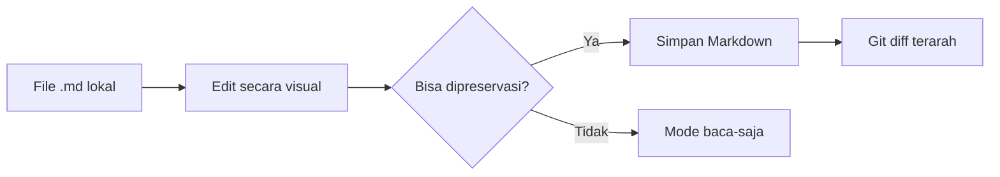

<div align="center">

# markpiw

**Edit Markdown seperti dokumen biasa, tanpa mengorbankan source dan git diff.**

[](https://github.com/avendisianipar/markpiw/releases/latest)
[](https://github.com/avendisianipar/markpiw/actions/workflows/ci.yml)
[](LICENSE)


[Unduh extension](https://github.com/avendisianipar/markpiw/releases/latest) ·
[Lihat fitur](#fitur-utama) ·
[Mulai berkontribusi](CONTRIBUTING.md) ·
[Laporkan masalah](https://github.com/avendisianipar/markpiw/issues/new/choose)

</div>

markpiw adalah editor Markdown WYSIWYG lokal untuk VS Code dan browser berbasis Chromium.
Anda mengedit langsung di tampilan jadi—seperti editor dokumen modern—sementara file `.md`
tetap menjadi sumber utama dan mudah di-review di Git.

> [!NOTE]
> Rilis stabil terbaru adalah `v1.0.0`. File tetap disimpan sebagai Markdown biasa sehingga
> dapat dibuka dan di-review tanpa markpiw.

## Mengapa markpiw?

| | |
|---|---|
| **Markdown tetap Markdown** | Tidak ada format dokumen tersembunyi atau lock-in. |
| **Diff tetap terarah** | Hanya blok yang Anda edit yang diserialisasi ulang; bagian lain dipertahankan. |
| **Lokal dan privat** | Tidak ada server, telemetri, atau analytics. |
| **Menyatu dengan VS Code** | Save, undo, redo, dan file workflow memakai mekanisme bawaan VS Code. |
| **Gagal dengan aman** | Jika perubahan tidak dapat disimpan tanpa mengubah makna dokumen, editor tidak menulis file. |



## Fitur utama

- Toolbar dan shortcut untuk heading, list, kutipan, task, tebal, miring, kode, dan coret.
- Slash menu (`/`) untuk tabel, code block, gambar, dan blok lainnya.
- Paste atau drag-and-drop gambar ke folder aset lokal.
- Dukungan GitHub Flavored Markdown (GFM), termasuk tabel dan task list.
- Preservasi source untuk menjaga perubahan di Git tetap mudah di-review.
- Tema terang dan gelap.
- Web app dengan mode demo yang tidak menyentuh file lokal.

<details>
<summary><strong>Lihat cara pakai singkat</strong></summary>

| Ingin | Caranya |
|---|---|
| Heading, list, kutipan, task | Ketik `# `, `- `, `1. `, `> `, atau `[ ] ` di awal baris |
| Tebal, miring, kode, coret | Ketik `**teks**`, `_teks_`, `` `teks` ``, `~~teks~~`, atau gunakan toolbar |
| Menu blok | Ketik `/` di baris kosong |
| Link | Pilih teks lalu tekan Ctrl/⌘+K |
| Gambar | Paste atau seret gambar ke editor |
| Simpan, undo, redo | Ctrl/⌘+S, Ctrl/⌘+Z, Ctrl/⌘+Shift+Z |

</details>

## Mulai cepat di VS Code

Yang Anda butuhkan hanya **VS Code 1.95 atau lebih baru**. Node, pnpm, dan clone
repository tidak diperlukan untuk memakai extension.

1. Unduh `markpiw.vsix` dari [rilis terbaru](https://github.com/avendisianipar/markpiw/releases/latest).
2. Buka panel **Extensions** di VS Code (Ctrl/⌘+Shift+X).
3. Klik **`…`** → **Install from VSIX…** lalu pilih file yang diunduh.
4. Klik kanan file `.md` → **Buka dengan markpiw**.

Atau unduh dan pasang lewat terminal:

```bash
gh release download --repo avendisianipar/markpiw --pattern '*.vsix'
code --install-extension markpiw.vsix
```

Untuk menjadikan markpiw sebagai editor default file Markdown, tambahkan konfigurasi berikut
ke `settings.json`:

```json
"workbench.editorAssociations": { "*.md": "markpiw.editor" }
```

Folder gambar default adalah `assets/` di samping file `.md`. Ubah melalui setting
`markpiw.assetsFolder` jika diperlukan.

<details>
<summary><strong>Update, migrasi dari versi lama, dan uninstall</strong></summary>

### Update

Extension yang dipasang dari `.vsix` tidak diperbarui otomatis. Unduh `.vsix` terbaru,
pasang dengan cara yang sama, lalu jalankan **Developer: Reload Window** jika diminta.

### Migrasi dari versi 0.1.0 lama

ID extension berubah dari `markpiw-internal.markpiw` menjadi `avendisianipar.markpiw`.
Uninstall extension dengan ID lama sebelum memasang versi baru. Setting
`markpiw.assetsFolder` tetap terbawa; tema mungkin perlu dipilih ulang sekali.

### Uninstall

Buka panel **Extensions**, pilih **markpiw**, lalu klik **Uninstall**.

</details>

<details>
<summary><strong>Troubleshooting</strong></summary>

- **markpiw tidak muncul di Open With.** Pastikan extension aktif, lalu jalankan
  **Developer: Reload Window**.
- **Instalasi ditolak karena versi VS Code.** Perbarui VS Code ke versi 1.95 atau lebih baru.
- **Editor menampilkan banner merah dan menjadi baca-saja.** Ada edit yang tidak dapat
  disimpan sebagai Markdown tanpa mengubah makna dokumen. markpiw tidak menulis perubahan
  tersebut. Pilih **Muat ulang dari file** untuk melanjutkan.
- **Perintah `code` tidak ditemukan di macOS.** Buka Command Palette dan jalankan
  **Shell Command: Install 'code' command in PATH**, lalu buka terminal baru.

Masih mengalami masalah? Buat [bug report](https://github.com/avendisianipar/markpiw/issues/new/choose)
dan sertakan langkah reproduksi, `git diff`, serta keluaran **Salin info diagnostik**.

</details>

## Versi web

Versi web belum di-host. Jalankan dari source dengan Chrome atau Edge:

```bash
pnpm dev:web
```

Buka `http://localhost:5173`. Tambahkan `?demo` untuk mencoba folder contoh tanpa menyentuh
file lokal. Lihat [panduan uji manual](docs/manual-testing.md) untuk skenario lengkap.

## Dukungan

| Target | Status |
|---|---|
| VS Code 1.95+ | Didukung |
| Chrome dan Edge | Didukung untuk web app |
| Firefox dan Safari | Belum didukung untuk membuka folder lokal |
| VS Code Marketplace | Belum tersedia; gunakan file `.vsix` dari Releases |

## Pengembangan lokal

Prasyarat: Node 24 dan pnpm 10 melalui Corepack.

```bash
corepack enable
pnpm install
pnpm dev:web          # web app di http://localhost:5173
pnpm package:vscode   # menghasilkan apps/vscode/markpiw.vsix
```

### Verifikasi

```bash
pnpm verify        # typecheck + lint + format + unit/property/upstream tests
pnpm test:e2e      # E2E web di Chrome (headless)
pnpm test:vscode   # integration test di VS Code
```

### Struktur repository

| Path | Isi |
|---|---|
| `vendor/prosemirror/` | Paket ProseMirror yang di-vendor tanpa modifikasi |
| `packages/markdown` | Parse GFM, preservasi source, serializer, dan round-trip guard |
| `packages/editor` | Controller, plugin, command, input rule, slash menu, paste, dan NodeView |
| `packages/ui` | Komponen React, toolbar, slash menu, popover, dan tema |
| `packages/host` | Interface `FileHost` |
| `apps/web` | SPA web untuk folder lokal dan mode demo |
| `apps/vscode` | Extension VS Code berbasis custom editor |

### Dokumentasi teknis

- [Panduan uji manual](docs/manual-testing.md)
- [Spesifikasi desain](docs/superpowers/specs/2026-10-28-markpiw-design.md)
- [Roadmap](docs/superpowers/plans/2026-10-28-markpiw-roadmap.md)
- [Architecture Decision Records](docs/adr/)
- [Panduan rilis extension](docs/releasing.md)
- [Dependensi dan lisensi pihak ketiga](docs/third-party.md)

## Berkontribusi

Kontribusi dalam bentuk bug report, usulan fitur, dokumentasi, dan kode diterima. Baca
[panduan kontribusi](CONTRIBUTING.md) sebelum membuka pull request. Semua partisipan wajib
mengikuti [Code of Conduct](CODE_OF_CONDUCT.md).

Kerentanan keamanan jangan dilaporkan melalui issue publik. Ikuti
[kebijakan keamanan](SECURITY.md) untuk pelaporan privat.

## Privasi

markpiw tidak memiliki telemetri, analytics, atau server. Isi dokumen tidak pernah dikirim
ke layanan markpiw.

- **Web app** membuka folder melalui File System Access API. Handle folder terakhir dan draf
  darurat disimpan di IndexedDB; tema dan state tampilan disimpan di localStorage.
- **Extension VS Code** hanya membaca dan menulis file yang Anda buka. Tema dan state tampilan
  disimpan melalui storage VS Code.
- **Gambar eksternal** (``) dimuat langsung dari server asal, seperti preview
  Markdown di GitHub atau VS Code. Gambar yang ditempel disimpan sebagai file lokal.

## Terima kasih kepada open source 💙

markpiw tidak mungkin terwujud tanpa karya para maintainer dan kontributor open source.
Terima kasih sebesar-besarnya kepada proyek-proyek berikut yang menjadi fondasi editor ini:

| Proyek | Kontribusi untuk markpiw |
|---|---|
| [ProseMirror](https://prosemirror.net) | Fondasi editor, document model, state, history, command, dan rendering editor. |
| [micromark](https://github.com/micromark/micromark) dan ekosistem [mdast](https://github.com/syntax-tree/mdast) | Parsing CommonMark, GFM, frontmatter, dan math dengan posisi source yang presisi. |
| [React](https://react.dev) dan [React DOM](https://react.dev/reference/react-dom) | Fondasi antarmuka web dan webview VS Code. |
| [React Aria Components](https://react-spectrum.adobe.com/react-aria/components.html) | Komponen toolbar, menu, popover, dan kontrol yang aksesibel. |
| [Floating UI](https://floating-ui.com) | Penempatan menu dan popover agar tetap tepat di sekitar selection. |
| [Lucide](https://lucide.dev) | Ikon antarmuka yang konsisten dan mudah dikenali. |
| [KaTeX](https://katex.org) | Pratinjau rumus matematika. |
| [Mermaid](https://mermaid.js.org) | Pratinjau diagram langsung dari code block Markdown. |
| [lowlight](https://github.com/wooorm/lowlight) dan [highlight.js](https://highlightjs.org) | Syntax highlighting untuk code block. |
| [Valibot](https://valibot.dev) | Validasi pesan antara extension VS Code dan webview. |

<details>
<summary><strong>Terima kasih juga kepada toolchain pengembangan</strong></summary>

[TypeScript](https://www.typescriptlang.org), [Vite](https://vite.dev),
[esbuild](https://esbuild.github.io), [pnpm](https://pnpm.io),
[Vitest](https://vitest.dev), [fast-check](https://fast-check.dev),
[Playwright](https://playwright.dev), [jsdom](https://github.com/jsdom/jsdom),
[ESLint](https://eslint.org), [Prettier](https://prettier.io), serta tooling extension dari
[Visual Studio Code](https://github.com/microsoft/vscode).

</details>

Terima kasih kepada setiap orang yang membangun, merawat, mendokumentasikan, menguji, dan
mendukung proyek-proyek tersebut. markpiw dapat berdiri dan berkembang karena karya mereka.

Daftar lengkap seluruh komponen yang benar-benar masuk ke bundle—termasuk dependency
transitif—beserta versi dan teks lisensinya dibuat otomatis sebagai `THIRD_PARTY_NOTICES.txt`
di setiap rilis. Ringkasan lisensi tersedia di [dokumentasi pihak ketiga](docs/third-party.md).

## Lisensi

[MIT](LICENSE) © 2026 Avendi Sianipar dan kontributor markpiw.
