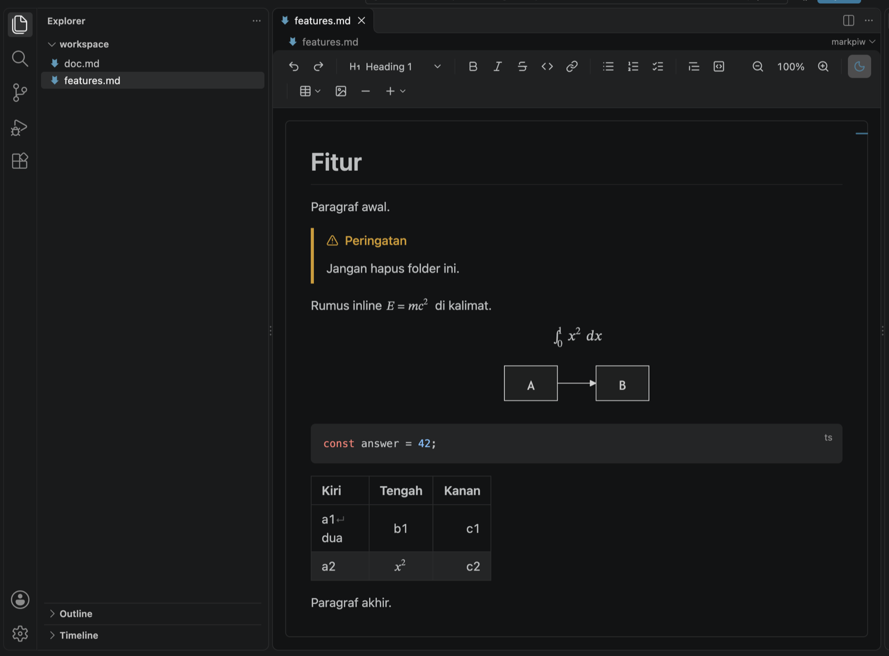
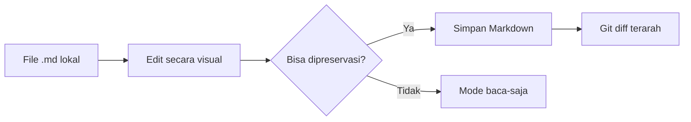

<div align="center">

# markpiw

**Edit Markdown seperti dokumen biasa, tanpa mengorbankan source dan Git diff.**

[](https://github.com/avendisianipar/markpiw/releases/latest)
[](https://github.com/avendisianipar/markpiw/actions/workflows/ci.yml)
[](LICENSE)


[Pasang di VS Code](#quick-start) ·
[Lihat fitur](#features) ·
[Mulai berkontribusi](#for-contributors) ·
[Laporkan masalah](https://github.com/avendisianipar/markpiw/issues/new/choose)

</div>

markpiw adalah ekstensi VS Code untuk mengedit Markdown secara visual seperti dokumen biasa.
File `.md` tetap menjadi sumber utama, dapat dibuka tanpa markpiw, dan mudah ditinjau melalui
Git diff.



<p align="center"><em>Markdown biasa, pengalaman mengedit visual, dan hasil yang tetap ramah Git.</em></p>

## Quick Start

1. [Unduh `markpiw.vsix`](https://github.com/avendisianipar/markpiw/releases/latest/download/markpiw.vsix).
2. Di VS Code, buka panel **Extensions** (Ctrl/⌘+Shift+X).
3. Klik menu **`…`** di bagian atas panel Extensions.
4. Pilih **Install from VSIX…**, lalu pilih file `markpiw.vsix` yang telah diunduh.
5. Di panel Explorer, klik kanan file `.md`, lalu pilih **Buka dengan markpiw**.

Selesai—Anda dapat mengedit Markdown secara visual dan menyimpannya seperti file biasa.

> [!IMPORTANT]
> Ekstensi yang dipasang dari `.vsix` tidak diperbarui otomatis. Untuk memperbarui markpiw,
> unduh rilis terbaru dan pasang file `.vsix` dengan langkah yang sama.

<details>
<summary><strong>Set markpiw as the Default Editor</strong></summary>

Buka file `.md`, jalankan **View: Reopen Editor With…** dari Command Palette, lalu pilih
**Configure default editor for '*.md'…** → **markpiw**.

Atau tambahkan properti berikut di dalam objek utama `settings.json`. Sesuaikan tanda koma
jika file sudah berisi pengaturan lain.

```json
"workbench.editorAssociations": {
  "*.md": "markpiw.editor"
}
```

</details>

<details>
<summary><strong>Terminal Installation</strong></summary>

Opsi ini memerlukan [GitHub CLI](https://cli.github.com/) dan perintah `code` yang tersedia
di `PATH`:

```bash
gh release download --repo avendisianipar/markpiw --pattern 'markpiw.vsix' --clobber &&
  code --install-extension ./markpiw.vsix --force
```

Perintah tersebut selalu mengambil aset dari rilis terbaru, menimpa file unduhan lama, dan
hanya menjalankan instalasi jika unduhan berhasil.

Jika perintah `code` tidak ditemukan di macOS, buka Command Palette, jalankan
**Shell Command: Install 'code' command in PATH**, lalu buka terminal baru.

</details>

<details>
<summary><strong>Image Folder Settings</strong></summary>

Secara default, gambar yang ditempel atau diseret ke editor disimpan di folder `assets/`
di samping file `.md`. Ubah melalui pengaturan `markpiw.assetsFolder` jika diperlukan.

</details>

<details>
<summary><strong>Update, Migration, and Uninstall</strong></summary>

### Update

Unduh `.vsix` terbaru, pasang dengan cara yang sama, lalu jalankan **Developer: Reload
Window** jika diminta.

### Migrate from Version 0.1.0

ID ekstensi berubah dari `markpiw-internal.markpiw` menjadi `avendisianipar.markpiw`.
Uninstall ekstensi dengan ID lama sebelum memasang versi baru. Pengaturan
`markpiw.assetsFolder` tetap terbawa; tema mungkin perlu dipilih ulang sekali.

### Uninstall

Buka panel **Extensions**, pilih **markpiw**, lalu klik **Uninstall**.

</details>

<details>
<summary><strong>Troubleshooting</strong></summary>

- **markpiw tidak muncul di Open With.** Pastikan ekstensi aktif, lalu jalankan
  **Developer: Reload Window**.
- **Instalasi ditolak karena versi VS Code.** Perbarui VS Code ke versi 1.95 atau lebih baru.
- **Editor menampilkan banner merah dan menjadi baca-saja.** Ada edit yang tidak dapat
  disimpan sebagai Markdown tanpa mengubah makna dokumen. markpiw tidak menulis perubahan
  tersebut. Pilih **Muat ulang dari file** untuk melanjutkan.

Masih mengalami masalah? Buat [bug report](https://github.com/avendisianipar/markpiw/issues/new/choose)
dan sertakan langkah reproduksi, versi VS Code, serta keluaran **Salin info diagnostik**.
Tambahkan contoh Markdown dan `git diff` jika aman dan relevan.

</details>

## Quick Usage

| Ingin | Caranya |
|---|---|
| Heading, list, kutipan, atau task | Ketik `# `, `- `, `1. `, `> `, atau `[ ] ` di awal baris |
| Tebal, miring, kode, atau coret | Pilih teks, lalu gunakan toolbar atau shortcut |
| Menu blok | Ketik `/` di baris kosong |
| Link | Pilih teks, lalu tekan Ctrl/⌘+K |
| Cari di dokumen | Ctrl/⌘+F atau tombol cari di toolbar; Enter / Shift+Enter untuk hasil berikutnya / sebelumnya |
| Gambar | Tempel atau seret gambar ke editor |
| Simpan, undo, atau redo | Ctrl/⌘+S, Ctrl/⌘+Z, atau Ctrl/⌘+Shift+Z |

## Why markpiw?

| | |
|---|---|
| **Markdown tetap Markdown** | Tidak ada format dokumen tersembunyi atau ketergantungan pada markpiw. |
| **Git diff tetap terarah** | Hanya blok yang diedit yang diserialisasi ulang; bagian lain dipertahankan. |
| **Diproses secara lokal** | markpiw tidak memiliki server, telemetri, atau analitik. |
| **Menyatu dengan VS Code** | Simpan, undo, redo, dan pengelolaan file memakai mekanisme bawaan VS Code. |
| **Gagal dengan aman** | Jika perubahan tidak dapat disimpan tanpa mengubah makna, editor tidak menulis file. |

<details>
<summary><strong>How markpiw Protects Markdown Files</strong></summary>



</details>

## Features

- Tampilan dokumen menyerupai GitHub untuk heading, list, tabel, callout, dan blok HTML umum
  seperti `<details>` dan `<summary>`.
- Toolbar, shortcut, dan menu `/` untuk format teks, list, tabel, kutipan, gambar, dan blok
  lainnya.
- Outline dokumen untuk berpindah antar-heading dengan cepat.
- Pratinjau rumus KaTeX, diagram Mermaid, dan pewarnaan sintaks pada blok kode.
- Dukungan GitHub Flavored Markdown (GFM), termasuk tabel dan task list.
- Tempel atau seret gambar langsung ke folder aset lokal.
- Preservasi source agar perubahan tetap mudah ditinjau melalui Git diff.
- Tema terang dan gelap.

## Compatibility and Limitations

| Target | Status |
|---|---|
| VS Code 1.95 atau lebih baru | Didukung |
| VS Code Marketplace | Belum tersedia; pasang `.vsix` dari GitHub Releases |
| Pembaruan otomatis | Belum tersedia untuk instalasi `.vsix` |
| Web app di Chrome dan Edge | Tersedia dari source untuk pengembangan dan pengujian lokal |
| Firefox dan Safari | Belum didukung untuk membuka folder lokal |

Jika suatu perubahan tidak dapat diserialisasi tanpa mengubah makna dokumen, markpiw masuk
ke mode baca-saja dan tidak menulis perubahan tersebut. Instruksi pemulihan akan ditampilkan
langsung di editor.

## Privacy

markpiw tidak memiliki telemetri, analitik, atau server. Isi dokumen tidak pernah dikirim
ke layanan markpiw.

- **Web app** membuka folder melalui File System Access API. Handle folder terakhir dan draf
  darurat disimpan di IndexedDB; tema dan state tampilan disimpan di localStorage.
- **Ekstensi VS Code** hanya membaca dan menulis file yang Anda buka. Tema dan status tampilan
  disimpan melalui storage VS Code.
- **Gambar eksternal** (``) dimuat langsung dari server asal, seperti preview
  Markdown di GitHub atau VS Code. Gambar yang ditempel disimpan sebagai file lokal.

## For Contributors

Kontribusi berupa bug report, usulan fitur, dokumentasi, pengujian, dan kode diterima. Sebelum
memulai, baca [panduan kontribusi](CONTRIBUTING.md) dan cari
[issue yang sudah ada](https://github.com/avendisianipar/markpiw/issues). Semua partisipan
wajib mengikuti [Code of Conduct](CODE_OF_CONDUCT.md).

Kerentanan keamanan jangan dilaporkan melalui issue publik. Ikuti
[kebijakan keamanan](SECURITY.md) untuk pelaporan privat.

### Local Development

Prasyarat: Node.js 24 atau lebih baru, pnpm 10 melalui Corepack, dan Git.

```bash
git clone https://github.com/avendisianipar/markpiw.git
cd markpiw
corepack enable
pnpm install
pnpm verify
```

Perintah yang paling sering digunakan:

```bash
pnpm dev:web          # web app lokal di http://localhost:5173
pnpm package:vscode   # menghasilkan apps/vscode/markpiw.vsix
pnpm test:e2e         # E2E web di Chrome headless
pnpm test:vscode      # uji integrasi di VS Code
```

Web app belum di-host. Setelah menjalankan `pnpm dev:web`, buka `http://localhost:5173` di
Chrome atau Edge. Tambahkan `?demo` untuk menggunakan folder contoh di memori tanpa memilih
folder lokal.

<details>
<summary><strong>Repository Structure</strong></summary>

| Path | Isi |
|---|---|
| `vendor/prosemirror/` | Paket ProseMirror yang di-vendor tanpa modifikasi |
| `packages/markdown` | Parse GFM, preservasi source, serializer, dan round-trip guard |
| `packages/editor` | Controller, plugin, command, input rule, slash menu, paste, dan NodeView |
| `packages/ui` | Komponen React, toolbar, slash menu, popover, dan tema |
| `packages/host` | Interface `FileHost` |
| `apps/web` | SPA web untuk folder lokal dan mode demo |
| `apps/vscode` | Ekstensi VS Code berbasis editor khusus |

</details>

<details>
<summary><strong>Technical Documentation</strong></summary>

- [Panduan uji manual](docs/manual-testing.md)
- [Spesifikasi desain](docs/superpowers/specs/2026-10-28-markpiw-design.md)
- [Roadmap](docs/superpowers/plans/2026-10-28-markpiw-roadmap.md)
- [Architecture Decision Records](docs/adr/)
- [Panduan rilis ekstensi](docs/releasing.md)
- [Dependensi dan lisensi pihak ketiga](docs/third-party.md)

</details>

## Open Source Acknowledgements 💙

markpiw tidak mungkin terwujud tanpa karya para maintainer dan kontributor open source.
Terima kasih sebesar-besarnya kepada proyek-proyek berikut yang menjadi fondasi editor ini:

| Proyek | Kontribusi untuk markpiw |
|---|---|
| [ProseMirror](https://prosemirror.net) | Fondasi editor, document model, state, history, command, dan rendering editor. |
| [micromark](https://github.com/micromark/micromark) dan ekosistem [mdast](https://github.com/syntax-tree/mdast) | Parsing CommonMark, GFM, frontmatter, dan math dengan posisi source yang presisi. |
| [React](https://react.dev) dan [React DOM](https://react.dev/reference/react-dom) | Fondasi antarmuka web dan webview VS Code. |
| [React Aria Components](https://react-spectrum.adobe.com/react-aria/components.html) | Komponen toolbar, menu, popover, dan kontrol yang aksesibel. |
| [Floating UI](https://floating-ui.com) | Penempatan menu dan popover agar tetap tepat di sekitar selection. |
| [Lucide](https://lucide.dev) | Ikon antarmuka yang konsisten dan mudah dikenali. |
| [KaTeX](https://katex.org) | Pratinjau rumus matematika. |
| [Mermaid](https://mermaid.js.org) | Pratinjau diagram langsung dari code block Markdown. |
| [lowlight](https://github.com/wooorm/lowlight) dan [highlight.js](https://highlightjs.org) | Syntax highlighting untuk code block. |
| [Valibot](https://valibot.dev) | Validasi pesan antara ekstensi VS Code dan webview. |

<details>
<summary><strong>Development Toolchain Acknowledgements</strong></summary>

[TypeScript](https://www.typescriptlang.org), [Vite](https://vite.dev),
[esbuild](https://esbuild.github.io), [pnpm](https://pnpm.io),
[Vitest](https://vitest.dev), [fast-check](https://fast-check.dev),
[Playwright](https://playwright.dev), [jsdom](https://github.com/jsdom/jsdom),
[ESLint](https://eslint.org), [Prettier](https://prettier.io), serta tooling ekstensi dari
[Visual Studio Code](https://github.com/microsoft/vscode).

</details>

Terima kasih kepada setiap orang yang membangun, merawat, mendokumentasikan, menguji, dan
mendukung proyek-proyek tersebut. markpiw dapat berdiri dan berkembang karena karya mereka.

Daftar lengkap seluruh komponen yang benar-benar masuk ke bundle—termasuk dependency
transitif—beserta versi dan teks lisensinya dibuat otomatis sebagai `THIRD_PARTY_NOTICES.txt`
di setiap rilis. Ringkasan lisensi tersedia di [dokumentasi pihak ketiga](docs/third-party.md).

## License

[MIT](LICENSE) © 2026 Avendi Sianipar dan kontributor markpiw.
